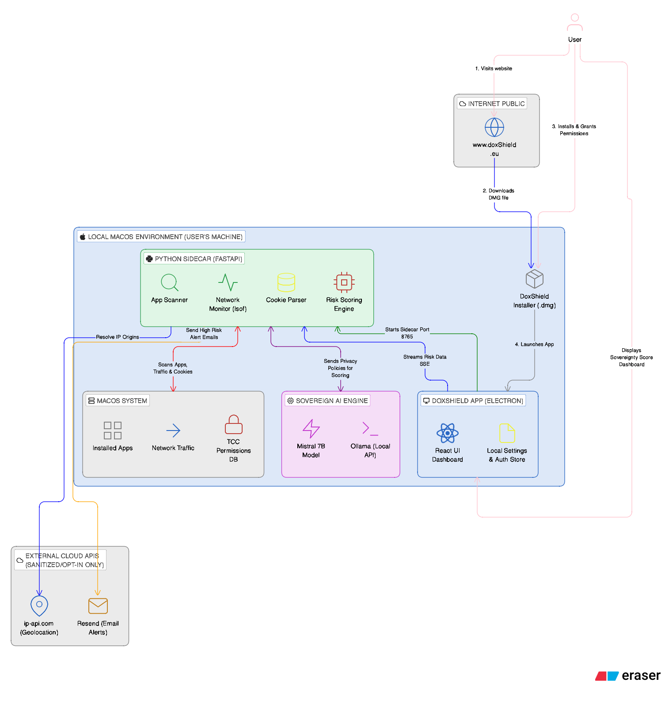

# 🛡️ DoxShield (by Team Exxeta1)
**Winner of the Q-Hack 2026 Exxeta Challenge: Digital Independence & Digital Sovereignty**

DoxShield is a real-time data sovereignty monitor for European consumers and businesses. It tells CISOs and users which of their installed Mac apps are sending data to non-EU jurisdictions, analyzes privacy policies with a local Mistral 7B model, and alerts you to high-risk network connections — **all without sending your data to any cloud.**

---

## 🏆 Exxeta Challenge: The Problem & Our Solution
To analyze vendor risk today (NIS2/DORA compliance), companies upload sensitive architecture data to cloud LLMs, compromising the very data they are trying to protect. You cannot achieve digital sovereignty using Big Tech cloud APIs.

**Our Solution:** A native macOS application powered by a completely local, on-device AI. 
- **Degree of Innovation:** We combined macOS system monitoring (`lsof`, TCC sqlite) with a local LLM (Mistral via Ollama/MLX) to evaluate EULAs offline.
- **Business Impact:** Highly scalable B2B SaaS model. CISOs can deploy DoxShield via MDM to all employee Macs to instantly map shadow IT and sovereign risk across the enterprise.

---

## 🏗 Architecture & Data Flow

All sensitive data processing happens securely within the local macOS environment. External APIs are only used for non-sensitive, sanitized tasks.



```text
 ┌─────────────────────────────────────────────────────┐
 │  Electron (React + TypeScript)                      │
 │  ┌───────────┐  ┌──────────┐  ┌──────────────────┐ │
 │  │  Sidebar  │  │ TitleBar │  │   Page Content   │ │
 │  │  (nav)    │  │ (status) │  │  (lazy-loaded)   │ │
 │  └───────────┘  └──────────┘  └──────────────────┘ │
 └───────────────────────┬─────────────────────────────┘
                         │ HTTP / SSE  (port 8765)
 ┌───────────────────────▼─────────────────────────────┐
 │  Python Sidecar (FastAPI + Uvicorn)                 │
 │  ┌──────────┐ ┌──────────┐ ┌──────────┐            │
 │  │ App scan │ │ Network  │ │ Cookies  │            │
 │  │ lsof     │ │ monitor  │ │ parser   │            │
 │  └──────────┘ └──────────┘ └──────────┘            │
 │  ┌──────────────────────────────────────┐           │
 │  │  Risk Engine (4-layer scoring)       │           │
 │  │  Jurisdiction · Policy · Perms · Net │           │
 │  └──────────────────────────────────────┘           │
 │  ┌──────────────────┐  ┌───────────────────────┐   │
 │  │  Ollama client   │  │  Resend email alerts  │   │
 │  │  (Mistral 7B)    │  │  (24h deduplication)  │   │
 │  └──────────────────┘  └───────────────────────┘   │
 └─────────────────────────────────────────────────────┘
```

### Risk Scoring Logic
```text
Sovereignty Score = 100 - Risk Score

Risk Score = weighted average of:
  -  Jurisdiction  (30%): US=15, UK=10, EU=0, CN/RU=25-40
  -  Policy AI     (20%): Mistral analysis of privacy policy text
  -  Permissions   (25%): sensitive permissions (location, contacts, camera)
  -  Network       (25%): CN/RU connections, known trackers, high frequency
```

---

## 🚀 5-Minute Demo
1. **Launch** `./start.sh` — app opens, sidecar starts.
2. **Skip onboarding** → lands on Consumer Dashboard.
3. Click **Rescan Now** → watch the SSE progress: `apps → permissions → network → cookies → AI → scoring`.
4. Observe the **Sovereignty Score** gauge update in real-time.
5. Click any app in the **Applications** list → App Detail page with 3 tabs.
6. Open **AI Analysis** tab → click "Analyse Policy" (runs fully locally on Mistral 7B).
7. Check **Network Monitor** → world map shows live connection origins.

---

## 🛠 Prerequisites & Setup

| Requirement | Version |
|-------------|---------|
| macOS       | 13 Ventura+ |
| Node.js     | 18+ |
| Python      | 3.11+ |
| Ollama      | Latest |
| Disk space  | ~5 GB (Mistral 7B model) |

### Quick Start (5 minutes)

```bash
git clone https://github.com/your-org/doxshield
cd doxshield
./setup.sh
```

The setup script will:
1. Check/install Homebrew, Python 3.11+, Ollama
2. Pull the Mistral 7B model (~4 GB, one-time download)
3. Create `sidecar/.venv` and install Python deps
4. Run `npm install`
5. Copy `.env.example` → `.env`

### Configure `.env`
```bash
# Optional — required for magic-link auth
CLERK_PUBLISHABLE_KEY=pk_test_...

# Optional — required for email alerts
RESEND_API_KEY=re_...

# Sidecar (defaults work out of the box)
SIDECAR_PORT=8765
OLLAMA_HOST=http://localhost:11434
OLLAMA_MODEL=mistral
```

### Run
```bash
./start.sh      # starts Ollama + Electron dev mode
```

---

## 🔒 macOS Permissions Required
DoxShield is deeply integrated with macOS to ensure accurate local scanning:

| Permission | Why | Where to grant |
|------------|-----|----------------|
| **Full Disk Access** | Reads TCC permission database | System Settings → Privacy & Security → Full Disk Access |
| **Network** | Monitors outbound connections | Granted automatically on first `lsof` run |
| **Notifications** | Alerts for high-risk activity | System Settings → Notifications → DoxShield |

> *Note: Without Full Disk Access, app permission data will be unavailable. Risk scores will still be calculated from jurisdiction and network data.*

---

## ⚙️ Build for Distribution
To compile the standalone macOS application (the DMG):
```bash
npm run build        # build renderer + preload
npm run build:mac    # create .dmg via electron-builder
```
Output: `dist/DoxShield-<version>.dmg`

---

## 📦 Project Structure

```text
DoxShield/
├── Exxeta1_Pitch.pptx  <-- Q-Hack 3-Minute Pitch Slides
├── electron/           <-- Electron main process
│   ├── main.ts         
│   ├── preload.ts      
│   └── sidecar.ts      
├── src/                <-- React renderer
│   ├── components/     
│   ├── pages/          
│   └── store/          
├── sidecar/            <-- Python backend
│   ├── main.py         <-- FastAPI app + routes
│   ├── scanner/        <-- App, network, cookie scanners
│   ├── ai/             <-- Ollama client + risk engine
│   └── data/           
├── setup.sh            <-- Idempotent setup script
└── start.sh            <-- Dev mode launcher
```

