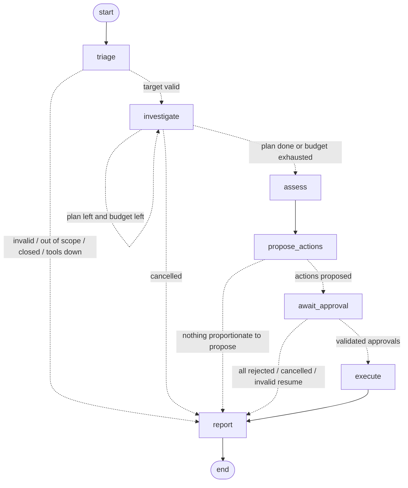

# M4 — LangGraph privacy-investigation agent

DoxShield provides **privacy-risk decision support** for human review. It does
not certify legal compliance and never states that a law was breached.

M4 adds one controlled, evidence-grounded LangGraph agent. It uses the M3 MCP
tools for every observation and action, and the M2 store for incidents,
approvals and the hash-chained audit log. Code lives in `sidecar/agent/`.

| Module | Responsibility |
|---|---|
| `graph.py` | State, the seven nodes, conditional routing, the approval interrupt, the report |
| `mcp_client.py` | MCP client session (official SDK); read/action scope split; timeouts; strict parsing |
| `evidence.py` | Evidence records (minimised, bounded, hashed, persisted); claim validation |
| `assessment.py` | Rule-based concerns and review priority; optional validated model explanation |
| `policy.py` | Opt-in privacy-policy statement extraction with verbatim-quote checks |
| `actions.py` | Deterministic, proportionate action proposals |
| `service.py` | Runs the graph, persists progress, decisions, revisions, cancel, restart recovery |
| `identity.py` | Principal resolution (signed token or fixture-only demo identities), roles, Origin guard |
| `api.py` | FastAPI routes mounted by `main.py` |
| `../incidents/approvals.py` | The single approval system (shared with the MCP action tools) |
| `../ai/llm_gateway.py` | The only path to a language model (off / local Ollama / record / replay) |

## Implemented graph

Generated from the compiled graph (`graph.get_graph().draw_mermaid()`); dashed
edges are conditional. A test asserts the node set matches this diagram.



| Node | What it does | Can it change state outside DoxShield? |
|---|---|---|
| `triage` | Checks the analyst role and target format; resolves the incident (`get_incidents`) or app (`list_apps`); closes resolved/dismissed incidents by rule; builds a deterministic plan | No |
| `investigate` | Runs **one** read-only MCP call per step, records evidence, expands the plan (e.g. tracker + jurisdiction checks per destination, capped at 3) | No |
| `assess` | Rule-based concerns, uncertainties and review priority; every claim checked against stored evidence; optional model explanation | No |
| `propose_actions` | Builds proportionate proposals and stores them as `proposed` | No |
| `await_approval` | `langgraph.types.interrupt` — the graph stops here | No |
| `execute` | Calls each validated, approved action once through MCP | Drafts / dry-run rule file only |
| `report` | Writes the report and audit events | No |

### State

`InvestigationState` (typed dict) holds: investigation id, target, objective,
requester and roles, stage, status, minimal resolved context, pending plan,
budget, tool-call history (tool, short args, ok, error code, duration, attempt),
evidence records, assessment, proposals, decisions, executions, errors, flags,
timeline and the final report. Raw scan payloads are not copied into state —
only the minimised evidence content.

## MCP interaction

`MCPToolClient` opens a client session over the official MCP SDK's in-memory
transport to the existing DoxShield FastMCP server (the same server that runs on
stdio). Therefore the server's argument validation, 15 s per-tool timeout and
approval gate apply to every agent call. The client adds:

* **Scope:** `call_read` accepts only the 12 read-only tools; `call_action`
  accepts only the 4 action tools and requires an `approval_id`. Investigation
  code never has a path to an action tool.
* **Client timeout** (20 s) in case the server hangs or is unreachable.
* **Strict parsing:** non-JSON, non-text or wrongly shaped results become
  `malformed_response` and are not used.

## Tool budget and termination

Defaults (`AgentConfig`; override with `DOXSHIELD_AGENT_MAX_TOOL_CALLS`,
`DOXSHIELD_AGENT_MAX_STEPS`, `DOXSHIELD_AGENT_MAX_EVIDENCE`):

| Limit | Default | On reaching it |
|---|---|---|
| MCP calls per investigation (**including retries**) | 14 | `budget_exhausted` flag; assess with partial evidence; human review |
| Graph steps (LangGraph recursion limit) | 40 | Run fails closed (`step_limit`); pending actions cancelled |
| Evidence records | 40 | Extra records dropped; `evidence_cap_reached` |
| Retries (read-only tools, timeout/unavailable only) | 1, with backoff | `evidence_unavailable:<tool>` |
| Retries for action tools | **0** (non-idempotent) | Failure recorded, never retried |
| Model calls | 4 (explanation + 1 repair + policy) | Rules-only assessment |
| Destinations followed up after `get_connections` | 3 | — |

Two consecutive `unavailable` results stop the tool loop (`mcp_unavailable`).
An unhandled exception fails the run closed and cancels its pending actions.

## Evidence and citations

Each evidence record has `id` (`EV-<run>-NN`), `source_tool`, `source_ref`,
`trust` (`observed`, `heuristic`, `reference`, `stored`, `ai`,
`external_untrusted`), `summary`, minimised `content`, `limitations`,
`retrieved_at` and a SHA-256 `hash`. Records are written to the
`investigation_evidence` table as they are retrieved.

Claims are typed **observed / inference / uncertainty / recommendation**.
`validate_claims` (run in code, against the database) rejects claims that cite
nothing (except uncertainties), cite an id this investigation never retrieved,
use an unknown kind, or state a legal conclusion. There is no numeric risk
score: `review_priority` (high / medium / low / undetermined) is a documented
rule — e.g. *high* = non-adequate destination **and** sensitive permissions.
Conflicting evidence (two real, different countries for one IP) and missing
evidence become explicit uncertainties.

## Language model gateway and data boundaries

`DOXSHIELD_LLM_MODE` = `off` (default) | `ollama` | `record` | `replay`.

* `ollama`/`record` only accept a **loopback** `OLLAMA_HOST`; any other host is
  refused, so prompts cannot leave the machine through the gateway. There is no
  hosted provider and no API key in M4.
* With no model, the assessment is rules-only and the UI says so. Nothing is
  fabricated: a missing recording returns "unavailable", not text.
* The model never chooses tools, never sets the priority and never proposes
  actions. It may only add an explanation whose every claim cites retrieved
  evidence; invalid output gets **one** repair attempt, then is dropped
  (`llm_fallback`).
* Data minimisation: evidence summaries are sent with IP addresses redacted
  (IPv4 and IPv6). The free-text objective is never sent.
* LangChain/LangSmith tracing is forced off (`sidecar/agent/__init__.py`);
  LangGraph pulls `langsmith` in transitively.

### Privacy-policy analysis

Off unless `DOXSHIELD_AGENT_FETCH_POLICIES=1` **and** a local model is
configured, because fetching contacts the vendor's website (it reveals only that
someone looked up that vendor's public policy). Only the public policy text and
the app's catalogue name go to the model — no scan data. The policy is wrapped
as untrusted data; instruction-like content is flagged
(`possible_prompt_injection_in_policy`); every extracted statement must be a
**verbatim** quote from the fetched text or it is dropped; statements are stored
as `external_untrusted` vendor claims, not verified behaviour. Unreachable
policies give `policy_unavailable`.

## Human approval

1. `propose_actions` stores each action with its exact arguments, a payload hash,
   the proposer (the analyst who started the run) and status `proposed`.
2. The graph pauses in `await_approval` (LangGraph `interrupt`).
3. An **approver** decides each action with a mandatory reason and the payload
   hash they reviewed (`POST …/actions/{id}/decision`). Refused if: not an
   approver; the approver started the investigation or proposed that version;
   the payload changed since it was shown; the action is not pending.
4. An **analyst** may revise a pending proposal; this creates a new version
   (new id, new hash), supersedes the old one and needs a fresh approval.
5. When no action is pending, the graph resumes. The resume value carries no
   authority: `await_approval` re-reads every approval from the store and
   re-validates it. A text such as `"approved"` or invented approval ids is
   ignored (`invalid_resume_ignored`) and every action is cancelled.
6. `execute` calls the MCP action tool; the tool calls `consume_approval`, which
   validates again and marks the approval used in one conditional `UPDATE`.

An approval is valid only for: the same action kind, the identical payload,
the same investigation and incident, an approver who is not the proposer, an
action still in `approved` state, unused, and younger than
`DOXSHIELD_APPROVAL_MAX_AGE_SECONDS` (default 24 h).

**Durability:** checkpoints are in memory. A pause survives while the sidecar
runs, not a restart. On start-up, paused or running investigations are marked
`interrupted` and their actions cancelled, so an approval can never execute
after a restart. A durable PostgreSQL checkpointer is deferred (see below).

## Action restrictions

| Action | What actually happens |
|---|---|
| `create_ticket` | Returns a ticket draft; no external ticket system is contacted |
| `draft_dpo_notification` | Returns a draft; nothing is sent |
| `send_alert_email` | Returns a draft; nothing is sent. Recipient comes only from the user's settings (`alert_email`, with email alerts enabled), never from tool output, policy text or the model |
| `propose_block_rule` | Writes a dry-run rule file under `~/.doxshield/block_rules`; the firewall is never changed; target must be a single hostname/IP |

Proposals are proportionate: only **medium/high** review priority leads to
proposals; low-priority findings stay as recommendations in the report.

## Roles and identity

`viewer` reads; `analyst` starts investigations, runs detection and revises
proposals; `approver` decides. Identity comes from the existing OTP login's
signed JWT (`Authorization: Bearer`), with roles from `DOXSHIELD_ROLES` or
`~/.doxshield/roles.json`. For demos on synthetic data only,
`DOXSHIELD_DEMO_IDENTITIES=1` enables an "Acting as" switch
(`X-DoxShield-Demo-User`); it is refused with the real macOS backend.
State-changing routes reject browser requests from non-local origins.

## Recovery behaviour (each has a test)

Invalid app/incident ids · malformed targets · missing incident · closed
incident · MCP server unavailable (at triage and mid-run) · tool timeout
(server- and client-side) · malformed tool output · tool error · budget
exhaustion · step limit · evidence cap · model unavailable · malformed model
output (repair, then fallback) · fabricated citations · legal-conclusion output ·
prompt injection in incident data and policy text · rejected, forged,
wrong-kind, expired, stale, self-, cross-investigation and modified-payload
approvals · duplicate execution and concurrent consumption · failed action (not
retried) · cancel while running and while paused · restart while paused ·
concurrent investigations.

## Running locally

From the repository root:

```bash
python3 -m venv .venv && .venv/bin/pip install -r sidecar/requirements.txt
.venv/bin/alembic upgrade head      # DATABASE_URL, default ~/.doxshield/doxshield.db
cd sidecar && DOXSHIELD_BACKEND=fixture DOXSHIELD_DEMO_IDENTITIES=1 ../.venv/bin/python main.py
```

With the fixture backend, the background monitor reads synthetic data only and
sends no alert email.

Then open **Investigations** in the app, click **Detect**, start an
investigation as *Analyst*, switch to *Approver* to decide.

An incident database created by M2/M3 `init_db` (no Alembic history) can be
upgraded with `alembic stamp 5894789b61cf && alembic upgrade head`; the API
answers 503 with this hint until then.

## Tests

```bash
DOXSHIELD_BACKEND=fixture pytest -q        # no network, no model, no API keys
```

`tests/test_agent_graph.py` (transitions, routing, budgets, termination,
cancel, restart, isolation), `test_agent_mcp.py` (protocol, scope, timeouts,
malformed output, outages), `test_agent_approvals.py` (interrupt and every
approval attack), `test_agent_llm.py` (gateway, validation, repair/fallback,
injection, minimisation, policy), `test_agent_evidence.py` (provenance, hashes,
conflicts, gaps), `test_agent_api.py` (identity, roles, Origin, UI flow).

## Known limitations

* Checkpoints are in memory (not durable across restarts) and kept for the
  process lifetime.
* Demo identities are for synthetic data only; with tokens, roles come from a
  local file/env var, not a directory service. The app-wide request guard blocks
  other websites, but other local processes are not authenticated.
* The investigation plan is deterministic; the agent does not decide which tool
  to call next. This is deliberate for safety and testability.
* The adequacy list and knowledge notes are M2/M3 placeholders (M5).
* Offline IP lookup cannot confirm the country for most addresses (it reports
  LOCAL/Unknown), which the assessment states as an uncertainty.
* The model explanation path has been tested with replayed outputs only; no
  real-model evaluation has been run (M7).

## Deferred to M5 and later

M5 sourced knowledge base and retrieval quality · M6 full Incidents / Approvals /
Audit pages · M7 evaluation harness (≥40 scenarios, baseline comparison) · M8
OpenTelemetry tracing · M9 PostgreSQL checkpointer, cloud deployment and any
hosted model (with explicit data-sharing authorisation) · production delivery of
emails/tickets.
